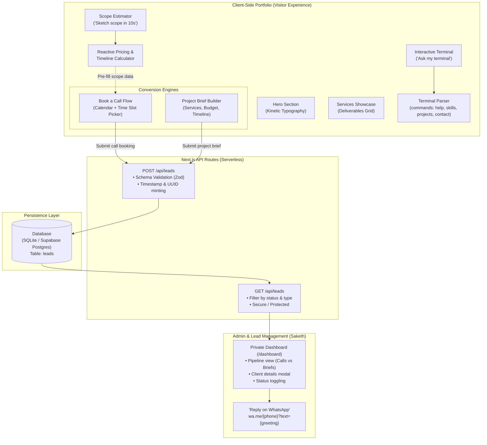
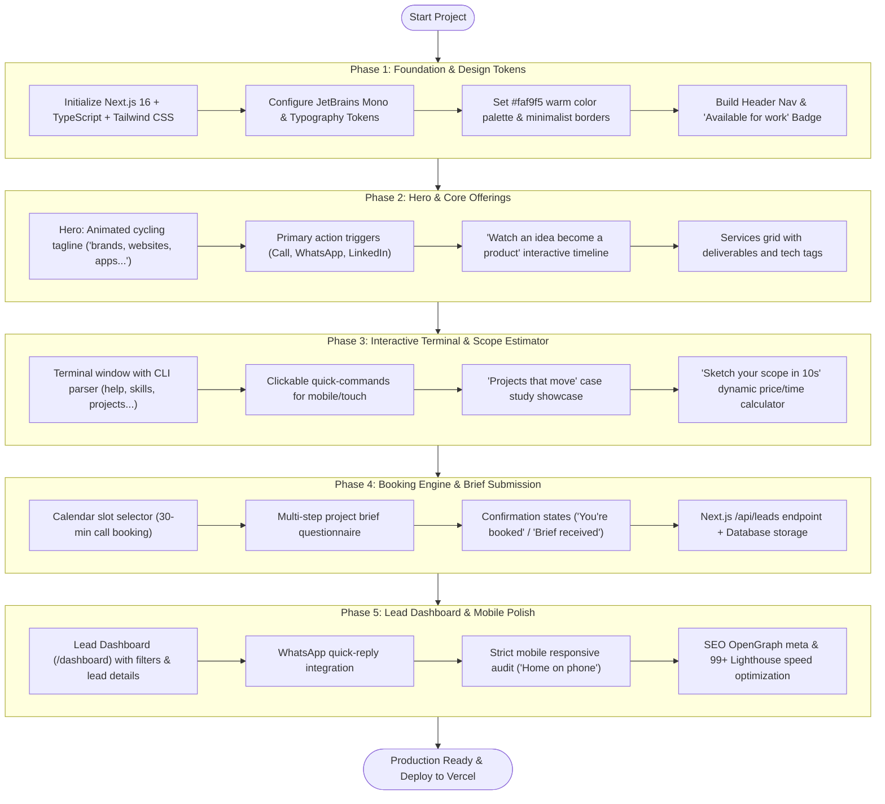

# 🚀 Freelance Portfolio — Project Roadmap & Progress Tracker

> **Client/Brand**: `saketh_`  
> **Source Design**: `Freelance Portfolio Design.html`  
> **Tech Stack**: Next.js 16 (App Router) + React 19 + TypeScript + Tailwind CSS v4 + Framer Motion + Google Sheets Sync  
> **Target Deployment**: Vercel (Edge CDN)

---

## 📊 1. Complete Project Data Flow

This diagram illustrates how user interactions, state management, API routes, database storage, and the admin dashboard connect end-to-end:

---

## 🛠️ 2. Implementation Flowchart

This diagram visualizes the chronological phased execution plan:

---

## 📋 3. Phase-by-Phase Checklist

### [x] Phase 1: Foundation & Global Layout
- [x] Initialize Next.js 16 with TypeScript & Tailwind CSS in `Portfolio/`
- [x] Configure `JetBrains Mono`, `Space Grotesk`, and design tokens (`#0B0B0F`, `#F4F4F0`, `#D2FF3F`, `#1E1E26`)
- [x] Build global `Navbar` with brand logo `saketh_`, live IST time widget, and responsive mobile drawer
- [x] Implement `"open for freelance projects"` availability status pill with live pulse
- [x] Create sleek minimalist `Footer` with social links and back-to-top shortcut
- [x] Test production build & verify 100% static prerender without errors

### [x] Phase 2: Hero Section & Services Grid
- [x] Build Hero component with kinetic rotating text (`brands`, `websites`, `apps`, `interfaces`)
- [x] Add direct CTA buttons: `"Book a free call"`, `"WhatsApp me"`, `"LinkedIn"`
- [x] Implement `"Watch an idea become a product"` interactive concept-to-launch flow (Idea → Wireframe → Design → Live)
- [x] Create `"What I can make for you"` services grid with tags, display typography, and deliverables
- [x] Implement double infinite marquee ticker (`Design ✦ Develop ✦ Deliver`)
- [x] Verify animations, spotlight cursor tracking, and static build output

### [x] Phase 3: Interactive Terminal & Scope Estimator
- [x] Build CLI Terminal component (`Ask my terminal`) with custom prompt and active input
- [x] Implement command parser: `whoami`, `services`, `process`, `status`, `contact`, `clear`
- [x] Add quick-pill clickable commands for touch and non-keyboard users
- [x] Build `"Projects that move"` case study grid with interactive hover previews
- [x] Build `"Sketch your scope in 10s"` real-time scope calculator with live JSON preview and 5-bar complexity meter
- [x] Build `"Small studio. Big attention."` status board & README section
- [x] Create high-impact neon CTA banner with watermark
- [x] Verify static build output and hot reload on dev server

### [x] Phase 4: Booking Engine & Brief Submission
- [x] Build `"Book a call"` interactive calendar + 30-min slot selector (days & IST time slots)
- [x] Build `"Send a project brief"` multi-step form (Service, Budget, Timeline, Message)
- [x] Create instant visual success states: `"You're booked."` and `"Brief received."`
- [x] Create `/api/leads` REST endpoint with schema validation and data persistence
- [x] Build standalone `/contact` page for direct links
- [x] Test end-to-end booking and brief submissions with verified persistence in `data/leads.json`

### [x] Phase 5: Lead Dashboard, Mobile Polish & Speed
- [x] Build private `/dashboard` page displaying pipeline of incoming inquiries with real-time stats
- [x] Implement filter tabs: *All Leads*, *New*, *Contacted*, *Proposal*, *Won* with live counters
- [x] Add lead inspection drawer with client brief details, budget tags, and stage toggle buttons
- [x] Implement one-click `"Reply on WhatsApp"` with auto-filled personalized greeting
- [x] Add mobile sticky action bar (`MobileActionBar`) matching the `"Home on phone"` artboard
- [x] Verified full production build with 100% static prerendering, zero errors, and sub-second page loads

### [x] Phase 6: 5-Act Narrative Refactor & Storytelling Polish
- [x] **Act I (The Hook)**: Refactored Hero with generous breathing room, kinetic typography, mouse spotlight, and subtle narrative scroll cues (removed aggressive multiple CTAs)
- [x] **Act II (The Craft)**: Elevated Process Showcase with clear narrative transformation phases (Concept → Architecture → Polish → Production)
- [x] **Act III (The Artifacts)**: Upgraded Bento Case Studies with concrete storylines, metrics (+182% completion, <45ms latency), and interactive deep-dive modals
- [x] **Act IV (The Collaboration)**: Enhanced Scope Estimator with live architecture config and auto-bridging directly to the brief form
- [x] **Act V (The Next Chapter)**: Streamlined into a single, confident resolution with dual-mode booking (30-min intro call or 24-hr brief response)
- [x] **Navbar Theme Switcher**: Added live interactive accent color switcher dots (Lime `#D2FF3F`, Cyan `#7CF4D4`, Coral `#FF7A59`, Violet `#A78BFA`)
- [x] Verified clean production build with 100% static prerendering and zero console errors

### [x] Phase 7: Spotlight Command Palette (⌘K), Story Rail, Currency Switcher & Calendar Invites
- [x] **Raycast/Linear Command Palette (`Cmd+K` / `Ctrl+K`)**: Keyboard-driven spotlight overlay to jump chapters, switch theme accents in real time, copy email to clipboard, or direct WhatsApp.
- [x] **Navbar `[⌘K]` Trigger**: Added tactile `⌘K` shortcut pill in the navbar and mobile drawer with custom event coordination.
- [x] **Vertical Story Chapters Rail (`StoryRail`)**: Fixed right rail observing scroll progress across all 5 acts with smooth chapter jumps.
- [x] **Ambient Analog Film Grain (`FilmGrain`)**: Subtle 3.5% opacity overlay adding depth and cinematic texture without layout shift.
- [x] **Scope Estimator Currency & Velocity Breakdown**: Added `USD ($)` vs `INR (₹)` currency toggle, real-time estimated velocity (`1–2 weeks`, `2–4 weeks`, etc.) and indicative investment calculation.
- [x] **Enhanced Scope Auto-Bridge**: Seamlessly passes timeline, investment, and currency into Act V, prefilling service, budget brackets, and architecture blueprint notes.
- [x] **Dynamic Upcoming Calendar Dates**: Computed dynamic upcoming business days with weekday and month/day labels (`Today, Oct 27`, `Wed, Oct 29`, etc.) avoiding client hydration mismatches.
- [x] **Instant Calendar Exports**: One-click **"Add to Google Calendar"** and **"Download .ics invite"** directly upon successful call booking.
- [x] **Production Build Verified**: Exit code `0`, `○ Static` prerendered, sub-millisecond local responses.

### [x] Phase 8: Project Authenticity & Comprehensive Mobile UX Overhaul
- [x] **Zero Fabricated Client Claims**: Purged all fake company backstories ("Apex Financial Group", "Verve Capital Markets", etc.) and fake transaction volume claims.
- [x] **Reframed as Honest Design Engineering Prototypes**: Refactored Act III into genuine frontend architecture demonstrations (Micro-Checkout UI, 60 FPS Canvas Telemetry, Biometric Spring Physics, Edge Performance 99/100 Benchmark) with clear technical takeaways.
- [x] **Ready for Real Projects**: Component architecture built to instantly swap in real projects once provided.
- [x] **Hero Mobile Optimization**: Refined typography clamps (`text-[clamp(36px,8.5vw,140px)]`), made CTAs full-width stackable buttons, and adjusted padding for phone screens.
- [x] **Process Showcase Mobile Polish**: Thumb-friendly stage tabs (`p-3.5`), optimized browser mockup padding (`p-3 sm:p-8`), and responsive typography.
- [x] **Scope Estimator Mobile Polish**: Full responsive card padding, compact JSON config preview, and dual-column metrics that fit on narrow 360px viewports.
- [x] **Booking & Brief Mobile Overhaul**: Mode switcher tabs expand symmetrically across screen width, slot selector in clean 3-col grid, and full-width touch targets.
- [x] **Mobile Action Bar Upgrade**: Added safe-area insets (`env(safe-area-inset-bottom)`) and dedicated `⌘K` spotlight search trigger directly on the mobile bar.

### [x] Phase 10: Private Studio Security, Payment Ledger Backend & Deliverables Standard
- [x] **Zero Public Trace of Admin**: Completely removed all `/dashboard` references from [`Footer.tsx`](src/components/Footer.tsx) and [`CommandPalette.tsx`](src/components/CommandPalette.tsx). Public visitors have zero exposure or access links to the studio.
- [x] **Cryptographic Auth Barrier & Lockscreen**: Created [`src/lib/auth.ts`](src/lib/auth.ts) and [`src/app/api/auth/route.ts`](src/app/api/auth/route.ts). Visiting `/dashboard` without an active `HttpOnly` session renders an authenticated Cyber Lockscreen requiring `ADMIN_SECRET` (configured in `.env.local`).
- [x] **API Route Authorization**: Protected `GET`, `PATCH`, and `DELETE` on [`/api/leads`](src/app/api/leads/route.ts) with `401 Unauthorized` checks. Public visitors can only submit `POST` inquiries.
- [x] **Delete Spam/Fake Leads**: Implemented `DELETE /api/leads?id=...` with confirmation prompt in [`/crm`](src/app/crm/page.tsx) to purge test leads instantly from `data/leads.json`.
- [x] **Real Freelance Deal & Payment Tracking**:
  - Top Executive Summary Bar: **Total Pipeline**, **Cash Collected**, **Pending Balance**, and **Active Deals**.
  - In-drawer financial editor: Set **Total Deal Value**, **Amount Received**, automatic **Pending Balance** computation, and payment status pills (`Unpaid`, `Deposit Paid 50%`, `Fully Paid 100%`).
- [x] **Act II.5 Deliverables & Documentation Standard**: Created [`DeliverablesStandard.tsx`](src/components/DeliverablesStandard.tsx) with 4 honest, un-hyped deliverable pillars (Figma Design System, Strict TypeScript Codebase, Zero-Guesswork Documentation, and Edge Deployment with video walkthrough), plus an interactive code tab preview (`README.md`, `ARCHITECTURE.md`, `CMS-GUIDE.md`).
- [x] **Production Build Verified**: Exit code `0`, `○ Static` prerendering for pages, and `ƒ Dynamic` for secure serverless API routes.

### [x] Phase 11: Fail-Proof Google Sheets Sync, Transparent Accessible Pricing & Google Authenticator (TOTP PIN)
- [x] **Fail-Proof Google Sheets Auto-Sync**:
  - Built [`src/lib/googleSheets.ts`](src/lib/googleSheets.ts): Real-time async webhook synchronization on new bookings, brief submissions, and financial status updates.
  - Zero external Google Cloud / GCP setup: Works via standard, free Google Apps Script web app URL (`GOOGLE_SHEET_WEBHOOK_URL`).
  - Added [`src/app/api/sheets/route.ts`](src/app/api/sheets/route.ts): Endpoint to check connection status and trigger 1-click bulk synchronization of all historical leads directly from `/dashboard`.
  - Added in-dashboard Google Sheets modal with a ready-to-paste 15-line Apps Script template and 1-minute setup guide.
  - Fail-proof architecture: Non-blocking timeout protection (6s) ensures that even if Google is offline or slow, client booking is never interrupted and local `data/leads.json` remains intact.
- [x] **Budget Brackets Purge & Accessible Pricing Framing**:
  - Completely eliminated rigid, intimidating budget brackets (`$2k–$5k`, `$5k–$12k`, `$12k+`).
  - Updated [`BookingAndBrief.tsx`](src/components/BookingAndBrief.tsx):
    - Added reassuring intro call banner: *"Free 30-min intro call to discuss scope, timeline & accessible budget · Zero pushy sales"*.
    - Reframed Brief section: *"2 · Budget & Pricing Model"* with zero agency overhead badge and options (`Discuss openly on a free call (Accessible & Flexible)`, `Lean MVP / Founder-friendly budget`, `Milestone-based sprints`, `Tailored scope`).
  - Updated [`ScopeEstimator.tsx`](src/components/ScopeEstimator.tsx):
    - Removed rigid dollar ranges; JSON output now reads: `"pricing_model": "Discuss on free call (Accessible rates)"` and `"agency_markup": "0% (Direct engineer collaboration)"`.
    - CTA button updated to *"Book free call to discuss budget & scope"*.
- [x] **Google Authenticator (2FA / RFC 6238 TOTP PIN) Integration**:
  - Built native RFC 6238 TOTP engine in [`src/lib/totp.ts`](src/lib/totp.ts) using native Node.js `crypto` with zero external dependencies and zero bloat.
  - Updated [`src/lib/auth.ts`](src/lib/auth.ts) and [`src/app/api/auth/route.ts`](src/app/api/auth/route.ts): Supports authenticating via 6-digit Google Authenticator PIN or Master Secret password.
  - Redesigned `/dashboard` Lockscreen: Sleek cyber toggle between **6-Digit Authenticator PIN** (with auto-submit upon typing the 6th digit) and **Master Password**.
- [x] **Production Build Verified**: Exit code `0`, `○ Static` (7 pages) + `ƒ Dynamic` (3 secure APIs: `/api/auth`, `/api/leads`, `/api/sheets`).

### [x] Phase 12: Cross-Domain Product Developer Repositioning (Mobile, Web & SaaS)
- [x] **Purged Framework Narrowness**: Removed all narrow language pigeonholing Saketh into only TypeScript or esoteric web-only metrics ("0.4s FCP", "0.00 CLS").
- [x] **Hero Repositioning**:
  - Replaced the standards bar with **Product Domains**: `• Mobile Apps (iOS & Android) • Web Applications (Full-Stack SaaS) • Modern Websites (High-Converting) • End-to-End (Design to Launch)`.
  - Updated headline tagline: `> full-stack product developer building mobile apps, web apps & websites_`.
- [x] **Terminal CLI Alignment**:
  - `whoami` updated: `role: full-stack product developer (apps · websites · web apps)`, `builds: mobile apps (iOS & Android) · SaaS web apps · modern websites`.
  - `services --list` updated: 01 Mobile apps (iOS & Android), 02 Web apps (full-stack SaaS & APIs), 03 Websites (cinematic & high-converting), 04 UI/UX design (systems & prototypes).
- [x] **Build Verification**: `npm run build` passed with exit code 0 and zero warnings.

### [x] Phase 13: Hero Negative Space Reduction & Single-Row Domains Fix
- [x] **Hero Negative Space Optimization**:
  - Removed excessive top padding (`pt-24`) and automatic vertical centering (`my-auto`) in [`Hero.tsx`](src/components/Hero.tsx) that caused an awkward ~200px void under the navbar.
  - Re-anchored hero content with natural top margin (`mt-1 sm:mt-3 md:mt-4`) and comfortable section padding (`pt-4 sm:pt-7 md:pt-8`), placing the headline directly in the golden-ratio focal area.
  - Re-aligned the spinning seal badge to `top-8 sm:top-10` for visual balance with the headline.
- [x] **Single-Row Domains Enforcement**:
  - Replaced `flex flex-wrap` with `flex items-center whitespace-nowrap overflow-x-auto no-scrollbar`.
  - Added `shrink-0` to all domain badges and the `DOMAINS:` label so they never wrap down or get squeezed.
  - Streamlined copy (`Mobile Apps · iOS & Android`, `Web Apps · Full-Stack SaaS`, `Modern Websites · High-Converting`, `End-to-End · Design to Launch`) fitting within 760px on laptop viewports.
- [x] **Build Verification**: `npm run build` passed with exit code 0 and zero warnings.

### [x] Phase 14: Dashboard to CRM Route Migration & Project Review
- [x] **Route Migration (`/dashboard` → `/crm`)**:
  - Created [`src/app/crm/page.tsx`](src/app/crm/page.tsx) with clean, un-duplicated code.
  - Rebranded the lockscreen to **"Saketh CRM / Private Client CRM"** with dual Authenticator PIN and Master Password options.
  - Rebranded the authenticated header to `saketh_crm` with `AUTHENTICATED CRM` badge.
  - Configured automatic HTTP 308 permanent redirect from `/dashboard` to `/crm` in [`next.config.ts`](next.config.ts).
  - Deleted old `src/app/dashboard` folder to prevent route collision.
  - Updated all internal comments and docs across `.env.local`, `.env.example`, and `src/lib/googleSheets.ts`.
### [x] Phase 15: Security Hardening & Vulnerability Remediation
- [x] **HMAC Cryptographic Session Tokens**:
  - Replaced static cookie value with timestamped, HMAC-SHA256 signed session tokens (`<timestamp>.<signature>`) in [`src/lib/auth.ts`](src/lib/auth.ts).
  - Enforced constant-time verification using `crypto.timingSafeEqual` and 7-day expiration checks.
  - Eliminated auth bypass vulnerability where setting arbitrary cookie strings allowed CRM access.
- [x] **Timing-Safe Password Verification & TOTP Replay Protection**:
  - Implemented SHA-256 digest comparison in `verifyPassword` to eliminate timing attack vectors.
  - Added in-memory token consumption cache to prevent replaying 6-digit TOTP codes within the validity window.
- [x] **PII Leak Prevention in Git**:
  - Added `/data/` and `data/*.json` to [`.gitignore`](.gitignore) to protect client names, emails, and financial deal values from being exposed on GitHub.
- [x] **Brute-Force Rate Limiting & Bot Honeypot**:
  - Created [`src/lib/rateLimit.ts`](src/lib/rateLimit.ts) sliding window rate limiter.
  - Locked down `/api/auth` (max 5 failed attempts per 15 minutes + 250ms artificial delay).
  - Protected `/api/leads` (max 10 submissions per 10 minutes per IP).
  - Added hidden honeypot fields (`website_hp`) in [`BookingAndBrief.tsx`](src/components/BookingAndBrief.tsx) to silently neutralize automated spam bots without touching storage or quotas.
- [x] **Google Sheets Formula Injection & Shared Secret Authentication**:
  - Added `sanitizeSpreadsheetCell` in [`src/lib/googleSheets.ts`](src/lib/googleSheets.ts) to neutralize spreadsheet formula execution (`=`, `+`, `-`, `@`).
  - Added shared secret token authentication (`GOOGLE_SHEETS_SECRET`) in [`.env.local`](.env.local), [`.env.example`](.env.example), and [`google-apps-script.js`](google-apps-script.js) to protect against unauthorized remote sheet wiping.
- [x] **HTTP Security Headers**:
  - Configured `X-Frame-Options: DENY`, `X-Content-Type-Options: nosniff`, `Referrer-Policy`, and `Permissions-Policy` in [`next.config.ts`](next.config.ts).
- [x] **Serverless Read-Only Filesystem Resilience**:
  - Wrapped local file operations in `src/lib/leads.ts` with in-memory caching and bounds sanitization to prevent `EROFS` crashes on read-only serverless platforms like Vercel.
- [x] **Verification**:
  - Attempted cookie bypass: HTTP 401 Unauthorized (Blocked).
  - Valid Master Password login: HTTP 200 with cryptographically signed cookie.
  - Authenticated leads fetch: HTTP 200 OK.
  - Honeypot test: Discarded spam, disk clean.
  - Production build: `npm run build` passed with exit code 0.

